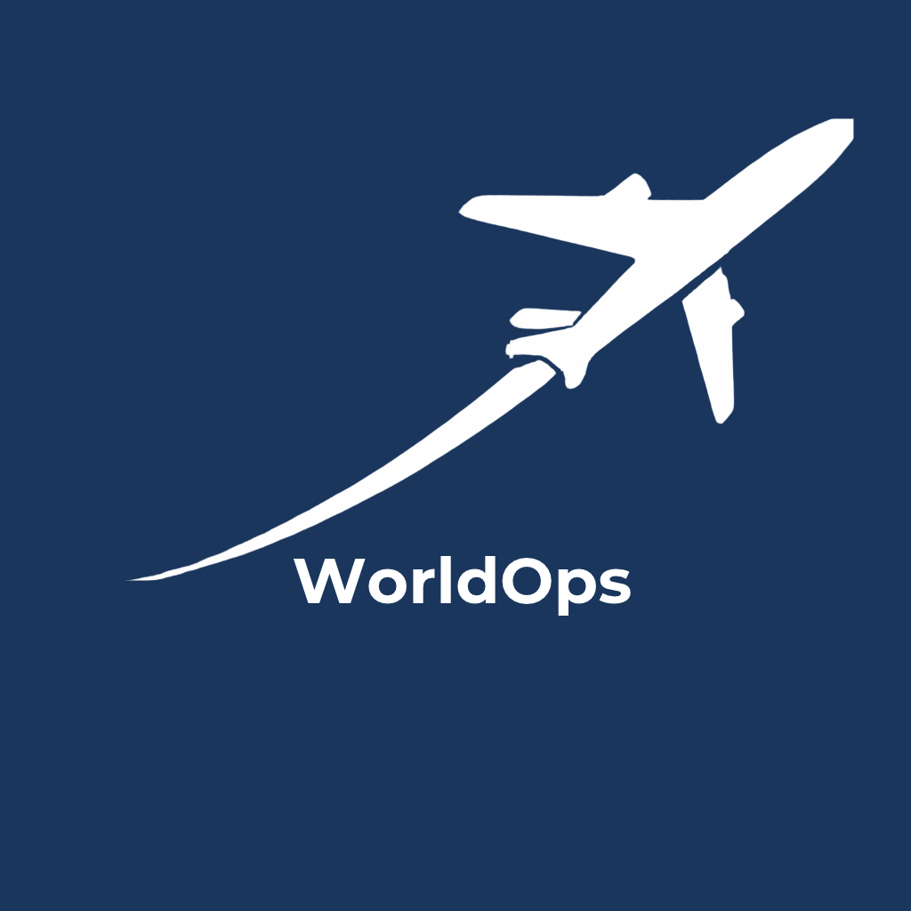

  

<h1 align="center">🛩️ WorldOps</h1>

  <strong>Crew Operations Platform</strong> 
  <em>A Swiss-made web application for flight crews</em>

  
  
  

  🌍 <a href="https://worldops.ch">Live App</a> •
  ✨ <a href="#features">Features</a> •
  🏗️ <a href="#architecture">Architecture</a> •
  🚀 <a href="#getting-started">Getting Started</a>

---

## Overview

Flight crews operate daily to multiple destinations worldwide, often with little time to prepare. Critical operational information (handling agents, hotel contacts, catering options, airport procedures) is typically shared informally through WhatsApp, emails, or word-of-mouth. Additionally, each crew member must track multiple travel documents (passports, visas) with different expiry dates.

**WorldOps** solves these problems by providing:

1. **Shared Destination Notes** — A collaborative knowledge base where crew members can add and search operational information by city or airport code (IATA/ICAO).
2. **Private Visa Management** — A secure personal area for passports and visas with automatic expiry alerts.
3. **Cross-platform Access** — PWA installable on iPhone, Android, and desktop.
4. **European Data Hosting** — Supabase (Frankfurt, EU) with a roadmap to Swiss hosting (Infomaniak).

🌍 **Live application**: [https://worldops.ch](https://worldops.ch)

---

## Features

### 📝 Destination Notes (Shared)
- Search airports by name, IATA code (e.g., `NCE`), or ICAO code (e.g., `LFMN`).
- Organize notes by category: Airport, Hotels, Catering, Handling, Language, Other.
- Real-time synchronization across all crew members via Supabase.
- Add custom destinations not in the database.

### 🔒 Private Area (Personal)
- Password-protected section (separate from the main app).
- Upload passports and visas with photos.
- Automatic expiry tracking.
- Color-coded alerts:
  - 🟢 **OK** — More than 60 days remaining.
  - 🟡 **Warning** — 30 to 60 days remaining.
  - 🔴 **Urgent** — Less than 30 days remaining.

### 📱 Progressive Web App
- Installable on home screen (iPhone, Android).
- Full-screen experience.

---

## Architecture

WorldOps runs entirely in the browser. No custom backend server is needed.

**System Components:**
- **Supabase** (Frankfurt, EU): PostgreSQL database for shared notes and real-time sync.
- **Woosmap** (France): API for airport suggestions by city name.
- **Airport Gap**: API for airport search by IATA code.
- **OurAirports**: Local SQLite database (85,000+ airports) loaded via WebAssembly.

**Why this design:**
- ✅ No server to manage 
- ✅ Redundancy — 3 search sources (if one fails, another works).
- ✅ Local SQLite ensures the core data is available even if external APIs fail.
- ✅ Data stays in Europe 

---

## Technology Stack

**Frontend**
HTML5, CSS3, JavaScript ES6+

**Data (Browser)**
sql.js (WebAssembly SQLite) + OurAirports (85,000+ records)

**Data (Cloud)**
Supabase (PostgreSQL, Frankfurt 🇪🇺)

**APIs**
Woosmap 🇫🇷 (city autocomplete), Airport Gap (IATA lookup)

**Hosting**
GitHub Pages (current), Infomaniak 🇨🇭 (roadmap)

---

## Security

**HTTPS**
Let's Encrypt via GitHub Pages

**Double Authentication**
App password + Private password (separate layers)

**Row-Level Security**
Supabase RLS policies (each crew member's data is protected)

**EU Data Hosting**
Supabase (Frankfurt, Germany)

**Swiss Roadmap**
Migration to Infomaniak (Geneva) for full data sovereignty, in the future.

---

## Getting Started

### Access the App
1. Open [https://worldops.ch](https://worldops.ch).
2. Enter the crew password: `LXICE`.
3. Search for a destination or click **Private** for visa management.

### Install as PWA
**On iPhone (Safari):**
1. Open the app in Safari.
2. Tap **Share** (□↑).
3. Tap **Add to Home Screen**.

**On Android (Chrome):**
1. Open the app in Chrome.
2. Tap **Install app** 

---

## Results

| Airport search response time | < 1 second |
| Supported airports | 85,000+ |
| Supported codes | IATA (3 letters) + ICAO (4 letters) |
| Alert types | 3 (🟢 OK, 🟡 Warning, 🔴 Urgent) |
| Supported devices | iPhone, Android, Desktop |
| Pilot Crew Members | 6 (LXICE crew) |

---

## Future Improvements

WorldOps is designed to evolve into a complete crew operations platform. Here is the roadmap:

### 🎯 Phase 1 — Short-term (Next 3 months)

**Authentication & User Management**
- [ ] Individual logins for each crew member (email + password).
- [ ] Password recovery via email.
- [ ] User profiles with photo and role.

**Document Management**
- [ ] Stock Onboard integration (Excel file → in-app table).
- [ ] Document sending to embassies via secure links.
- [ ] Visa renewal reminders via email.

**Notifications**
- [ ] Push notifications for visa expiry (30/60/90 days before).
- [ ] Email alerts to crew members.
- [ ] In-app notifications for new destination notes.

### 🚀 Phase 2 — Mid-term (6 months)

**🥃 Alcohol Stock Onboard (AI-powered)**
- [ ] Photo recognition of bottle labels — crew takes a picture, and the system automatically identifies the brand and enters the details.
- [ ] Automatic bottle counting with a simple **+1 / -1** interface — tap to update the count in real time.
- [ ] Low stock alerts when bottles are running low.

**🔧 Maintenance Module**
- [ ] Issue reporting with photo upload — crew can document any problem on board (broken seat, faulty light, etc.).
- [ ] Maintenance request — send photos and details directly to the maintenance team.
- [ ] Status tracking: Reported → In Progress → Resolved.

**Infrastructure**
- [ ] Migration to Infomaniak (100% Swiss hosting 🇨🇭) in the future.
- [ ] Multi-crew support: Independent crews with isolated data.
- [ ] Offline-first: Full offline functionality with sync, maybe in the future.

### 🌟 Phase 3 — Long-term (12 months)

**Mobile Applications**
- [ ] Native iOS app (App Store).
- [ ] Native Android app (Google Play).
- [ ] Apple Watch / Wear OS companion.

**Advanced Features**
- [ ] Crew scheduling and roster management.
- [ ] Training records and certifications tracking.
- [ ] Expense management for layovers.

### 💡 Long-term Vision

> *"WorldOps aims to become the reference tool for flight crews worldwide — a single platform where every crew member can find destination intelligence, manage their documents, track onboard stock, and report maintenance issues. Built in Switzerland, hosted in Europe, and designed for global aviation."*

---

## Contributors

**Laetitia Blanc** — Developer & LXICE crew member
- GitHub: [@mumin0](https://github.com/mumin0)
- Live app: [worldops.ch](https://worldops.ch)

---

## License

This project is licensed under the **MIT License**.

---

  🇨🇭 Made with ❤️ in Switzerland 
  ✈️ For flight crews, by flight crews

